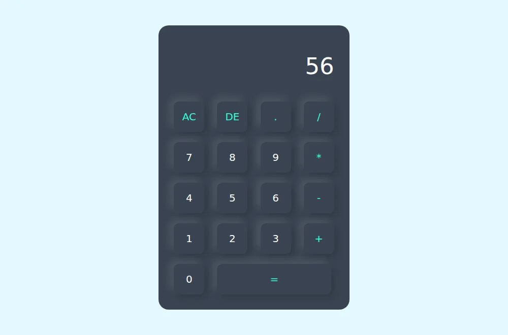

# Browser Calculator

An early HTML and CSS practice project with a button grid for basic arithmetic. It supports addition, subtraction, multiplication, division, clearing, and deleting the last character.

## Run locally

Open [`index.html`](index.html) in a browser. There are no dependencies or build steps.

The original demo evaluates the editable display with JavaScript `eval()`. Keep it as a local practice example. A production calculator should use a restricted arithmetic parser.
